# Aetherion

A tactical multiplayer survival shooter and battle royale built with Godot 4.7. Players parachute in with their squad, navigate darkened urban corridors and compound structures for weapons and supplies, manage dynamic flashlight and power reserves, and outmaneuver rival fireteams under an unforgiving day/night cycle driven by an overhead artificial sun.

- **Status and test evidence:** [docs/CHECKLIST.md](docs/CHECKLIST.md)
- **Third-party assets and licenses:** [docs/ASSET_MANIFEST.md](docs/ASSET_MANIFEST.md)
- **Performance benchmarks:** [docs/PERFORMANCE.md](docs/PERFORMANCE.md)

---

## Map Showcase

Map screenshots from version **0.25.0**, captured on **November 2, 2026**. Malasugue Mall and Freight Delight use their normal night lighting; Sitio Kalinaw is shown during the daytime phase.

### Malasugue Mall

A five-storey shopping mall with damaged shops, worn tile floors, working and broken escalators, and open elevator cabins beneath exposed shafts. Cold fluorescent lights and emergency lamps illuminate parts of the building, while the upper galleries overlook the atriums below.

| Grand Atrium (Level 1) | North Elevator Lobby |
| :---: | :---: |
| 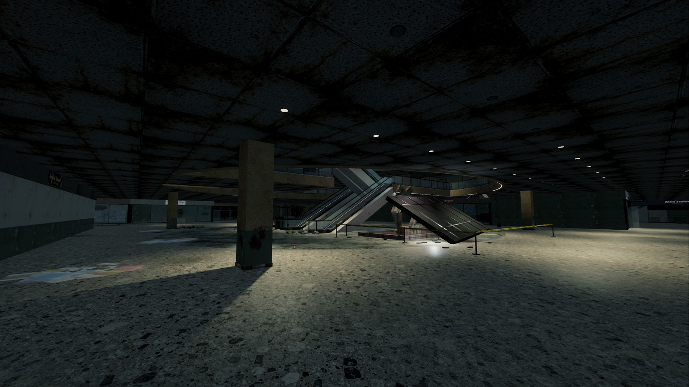 | 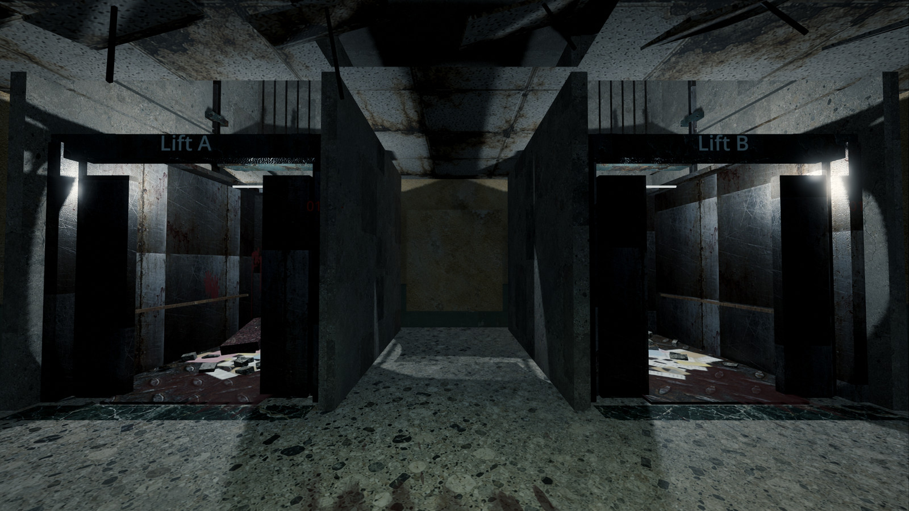 |

| Retail Concourse | Damaged Shopfronts |
| :---: | :---: |
| 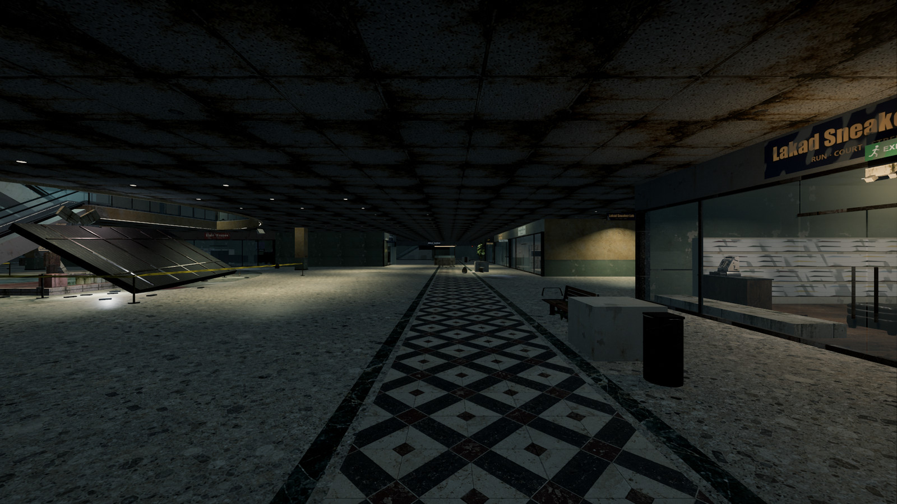 | 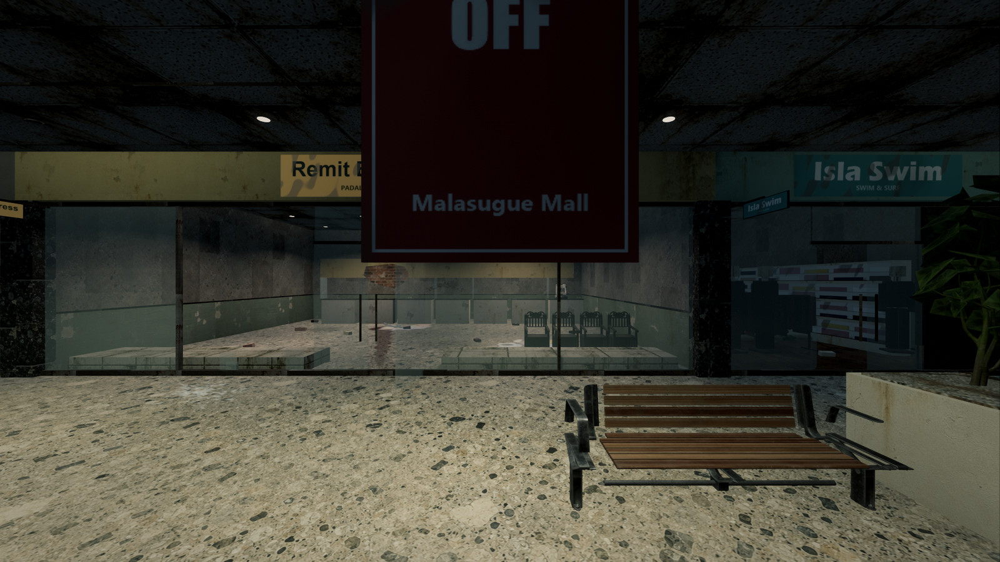 |

| Upper Gallery (Level 3) | West Court Escalators |
| :---: | :---: |
| 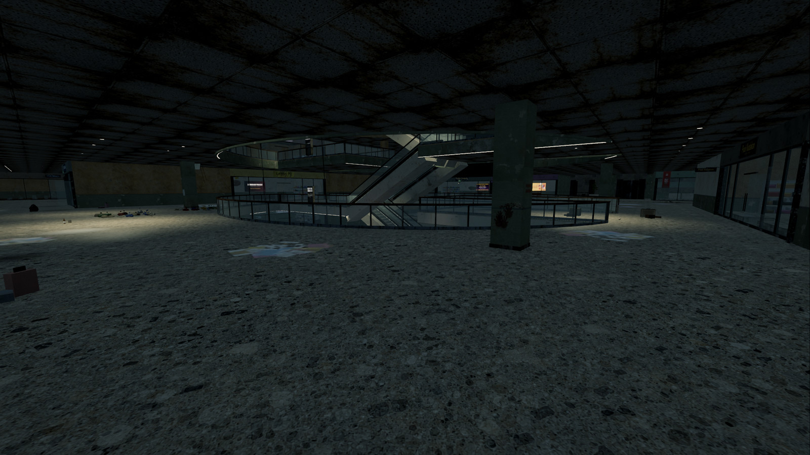 | 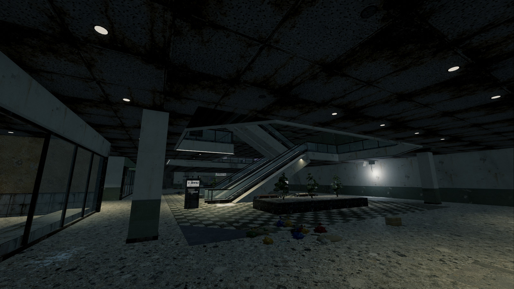 |

---

### Freight Delight

A settlement built inside an old container yard by the port. Container homes, a fish-landing shed, a warehouse, a repair shop, and narrow residential alleys connect through a crane plaza. Stairs and bridges lead to rooftop decks and the crane platform. The map stays at night throughout the match.

| Container Canyon | Fish Landing Shed |
| :---: | :---: |
| 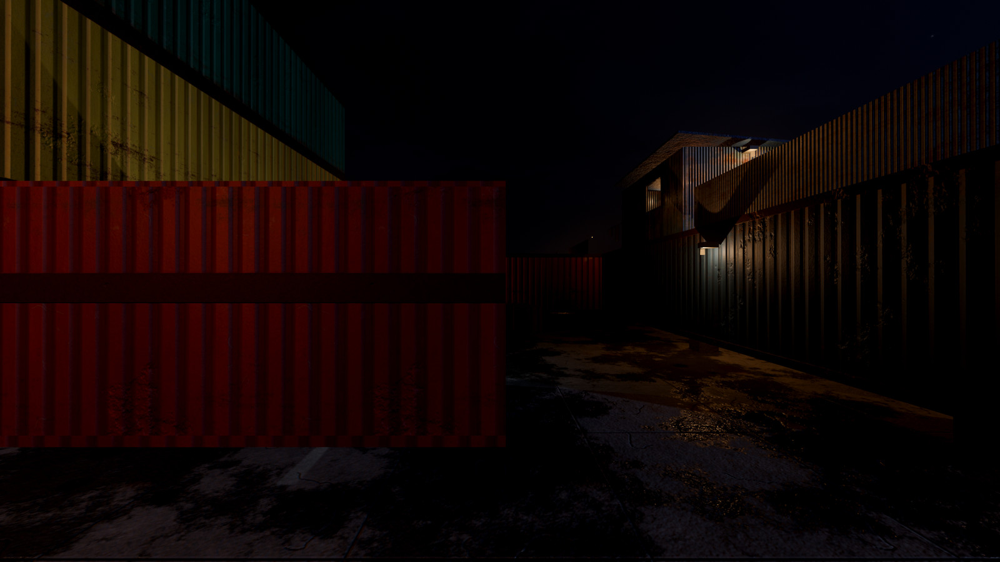 | 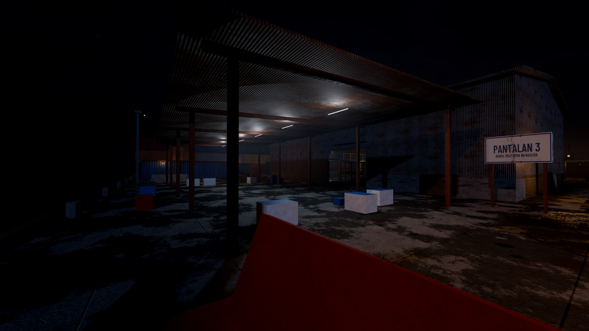 |

| Crane Plaza | Residential Alley |
| :---: | :---: |
| 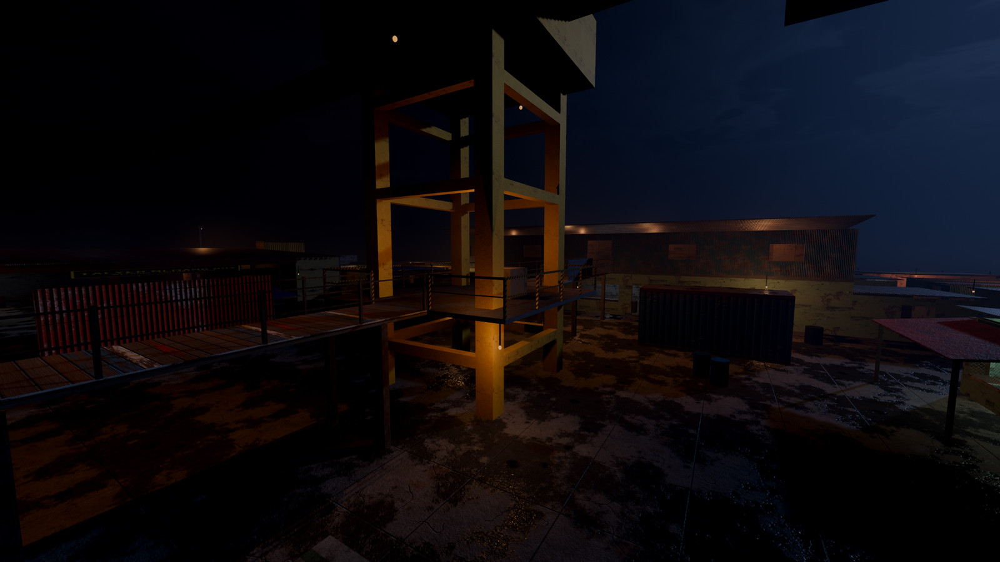 | 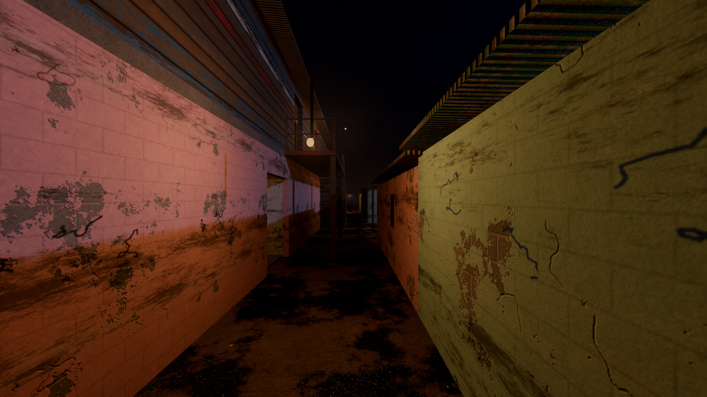 |

---

### Sitio Kalinaw

A riverside settlement with closely packed houses, rooftop paths, covered alleys, markets, and bridges. Matches begin in darkness before the artificial sun lights the streets. These views show the settlement during its daytime phase.

| Settlement from Above | River Boardwalk |
| :---: | :---: |
| 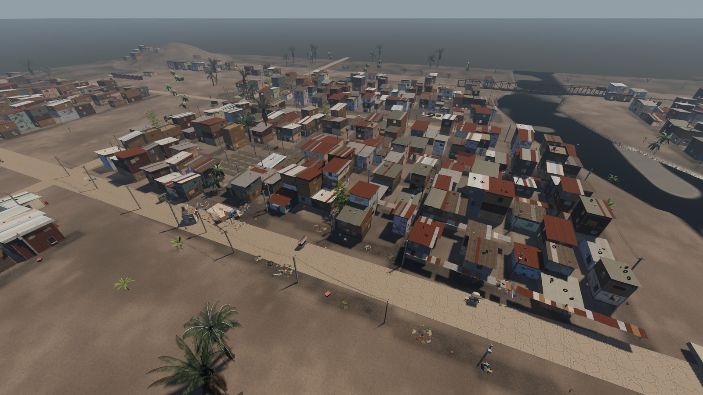 | 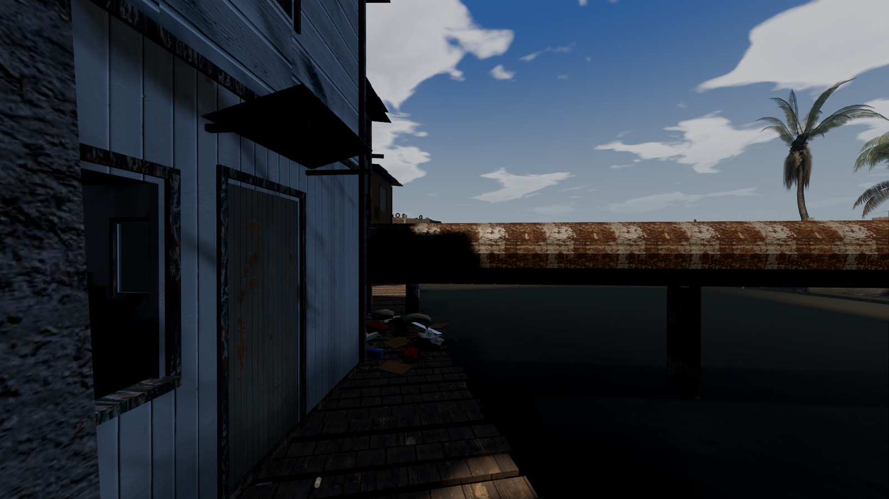 |

| Covered Alley | Residential Courtyard |
| :---: | :---: |
| 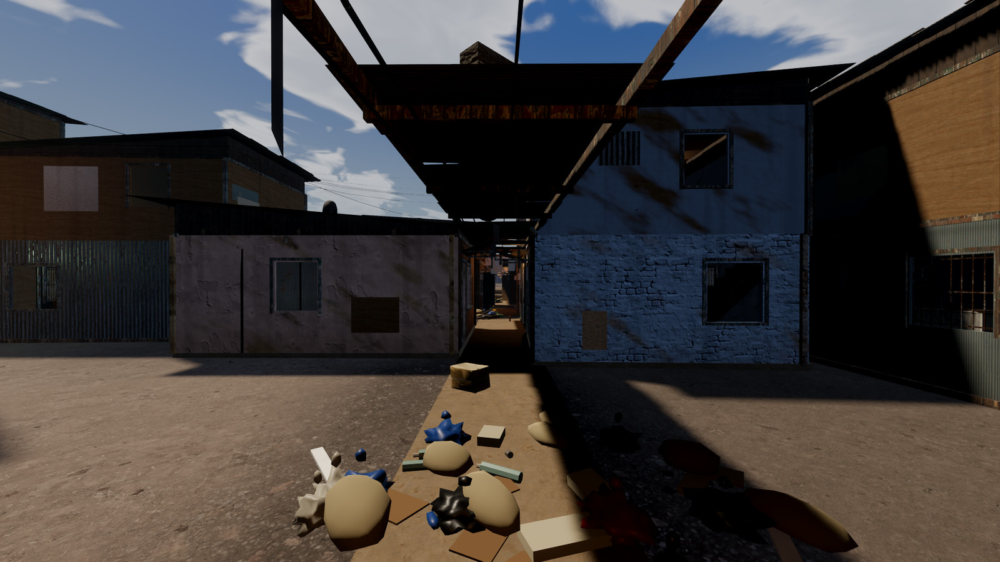 | 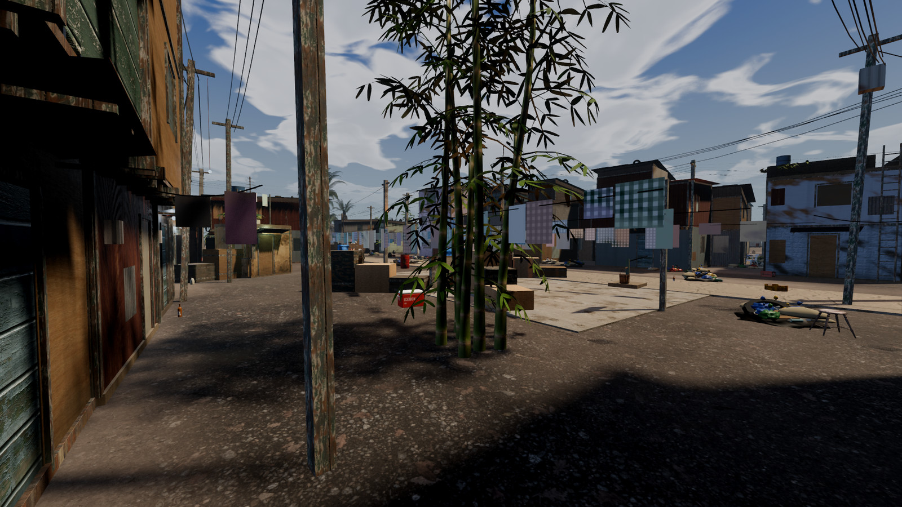 |

---

### 3D Weapon Customization & Attachment Workbench
Inspect and calibrate weaponry with an interactive 3D workbench. Mount optics, muzzle devices, tactical lasers, angled/vertical grips, and drum magazines directly onto weapon hardpoints in real time.

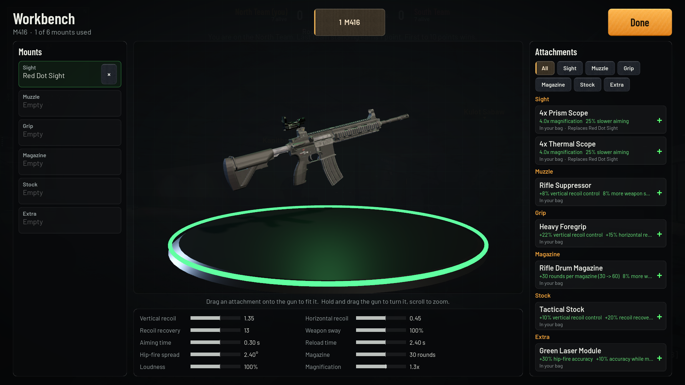

---

## Core Gameplay

### Tactical Insertion & Atmospheric Combat
- **Squad Drops:** Squads deploy via high-altitude cargo plane, controlling freefall trajectory and canopy flare to choose advantageous landing sectors.
- **Dynamic Day/Night Cycle:** Matches open in near-total darkness. Loudspeaker sirens issue timed warnings before an artificial sun ignites overhead, instantly transforming dark streets into high-visibility kill zones before eventually cutting back to black.
- **Resource Management:** Flashlights and electronics depend on battery reserves found across the field. Swapping depleted cells mid-firefight requires physical timing.
- **Physical Ballistics & Penetration:** Full server-side ballistics simulation. Rounds leave caliber-appropriate entry and exit holes through drywall, concrete masonry, sheet metal, and wood. Doors and window shutters fragment and break apart under sustained fire.
- **Tactical Audio & Directional Comms:** Proximity radio voice communication featuring realistic squelch cues, signal drop-off, and directional acoustic propagation through corridors and doorways.

### Weapon Systems & Ballistics
Twelve distinct firearms across multiple categories:
- **Sidearms & Pistols:** 9mm Service Pistol, .45 Tactical Pistol, .357 Heavy Revolver
- **Shotguns:** 12-Gauge Pump-Action, Break-Action Double-Barrel Shotgun, Improvised Pipe Shotgun
- **Submachine Guns:** 9mm Tactical SMG, Machine Pistol
- **Rifles & Carbines:** 5.56mm Assault Rifle, 7.62mm Battle Rifle
- **Precision Platforms:** .308 Designated Marksman Rifle (DMR), .308 Bolt-Action Sniper Rifle

Each weapon accepts specific tactical mounts:
- **Optics:** Micro Red Dot, Holographic Sight (1x), 2x, 3x, 4x Combat Scopes, 6x, 8x Long-Range Scopes, Thermal and Night Vision Scopes.
- **Muzzle Devices:** Caliber-specific suppressors (sound dampening + muzzle flash reduction), compensators (recoil mitigation), flash hiders, and shotgun chokes.
- **Foregrips & Accessories:** Vertical grips, angled foregrips, weapon lights, and visible tactical laser modules.
- **Feed Systems:** Extended magazines, quickdraw magazines, and drum magazines.

---

### Game Modes

- **Battle Royale (Classic Survival):**
  Full-scale survival match for up to 28 players across squads of 1 to 4. Drop into the map, scavenge weaponry and gear, monitor the closing environmental barrier, and survive rotating lighting conditions.
- **Tactical Elimination (Deathmatch):**
  Team-based round elimination on focused tactical maps (Commercial Mall, Freight Terminal, Suburban District). Features instant loadouts, round-wipe scoring, and spectator cameras.

---

### Advanced Bot AI & Universal Navigation

Bots operate on dedicated behavioral mind states and role specialization:
- **Rushers:** Aggressive assault units that sprint toward recent audio contacts, gunfire, or squad pings.
- **Snipers:** Position along long-range sightlines and elevated balconies, utilizing scopes and breaking cover after engagements.
- **Ambushers & Campers:** Secure defensive choke points, hold corners facing entryways, and reposition dynamically when discovered.
- **Stalkers:** Move quietly between cover, utilizing crouch walks and flanking vectors to catch opponents off-guard.
- **Dynamic Learning:** Across matches, bots analyze death coordinates, combat hotspots, and high-value sniper perches, organically adapting their traversal routes.

---

## Controls

| Action | Key / Input | Action | Key / Input |
|---|---|---|---|
| **Movement** | `W` `A` `S` `D` | **Jump / Vault / Flare Canopy** | `Space` |
| **Sprint / Walk / Crouch** | `Shift` / `Ctrl` / `C` | **Interact / Take Item / Revive (Hold)** | `E` |
| **Fire / Aim Down Sights** | `Left Mouse` / `Right Mouse` | **Reload** | `R` |
| **Weapon Selection** | `1` `2` `3` / `Scroll Wheel` | **Fire Mode Selector** | `B` |
| **Holster Weapon** | `X` | **Flashlight Toggle / Swap Battery** | `F` (Tap) / `F` (Hold) |
| **Tactical SmarTab / Inventory** | `Tab` (Hold) | **SmarTab Navigation** | `Q` / `E` (While Held) |
| **Map Screen** | `M` (Hold) | **Quick Medical Kit** | `H` |
| **Carry / Drag Object** | `T` | **Frag Grenade** | `G` |
| **Tactical Ping (Directs Squad Bots)** | `Middle Mouse` | **Push to Talk (Radio)** | `Caps Lock` |
| **Laser Pointer** | `V` (Hold) | **Chat / Menu** | `Y` / `Esc` |
| **Ladder Climb** | Walk into ladder (`W` Up, `S` Down) | **Ladder Release** | `Space` |

---

## Requirements & Setup

### Requirements
- **Engine:** Godot Engine **4.7.2** (Standard build).
- **OS & Graphics:** Windows 10/11, Linux, or Android 7.0+ (ARM64). Vulkan-compatible GPU recommended; OpenGL ES 3.0 supported for mobile compatibility.
- **Asset Tools (Optional for rebuilds):** Python 3.11+ (numpy, Pillow), Blender 5.2.

### Quick Start
Open `game/project.godot` in Godot 4.7.2 and click **Play**, or run via command line:

```bash
# Launch practice deathmatch with bots on the Mall map
godot --path game -- --host --game_mode=deathmatch --bots=19 --autostart=1

# Launch on the Freight Terminal map
godot --path game -- --host --game_mode=deathmatch --map=freight_delight --bots=23 --autostart=1

# Run a dedicated match and stats server
godot --headless --path game -- --server --stats --bots=19 --autostart=2 --expect_players=1
```

---

## Repository Structure

| Path | Description |
|---|---|
| `game/data/` | Configuration files for weapons, ballistics, item pools, match rules, and sound sets |
| `game/src/core/` | Autoloaded singletons: game definitions, global settings, lifecycle state |
| `game/src/match/` | World simulation, match authority, server synchronization, player interaction |
| `game/src/player/` | Character controller, first-person kinematics, third-person mesh rigging |
| `game/src/weapons/` | Weapon logic, projectile physics, recoil profiles, attachments workbench |
| `game/src/world/` | Procedural level builders, district layouts, lighting schedules, dynamic doors/props |
| `game/src/ai/` | Multi-tier bot navigation, behavior trees, and spatial waypoint networks |
| `game/src/ui/` | Tactical HUD, SmarTab interface, interactive locker, settings, scoreboard |
| `tools/` | Automated build tools, asset pipelines, testing harness, and validation scripts |
